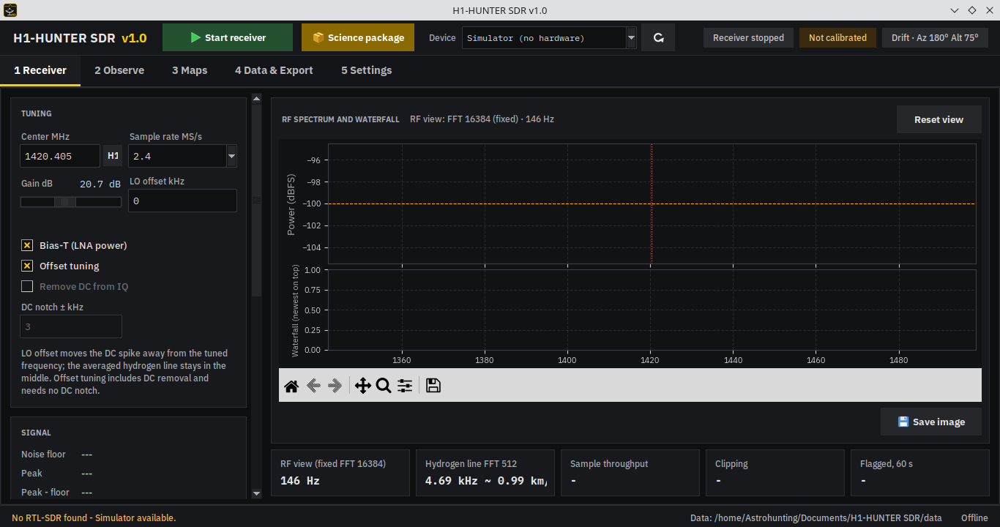
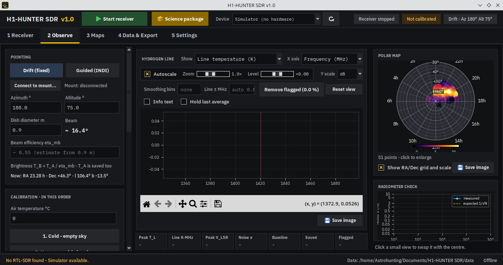
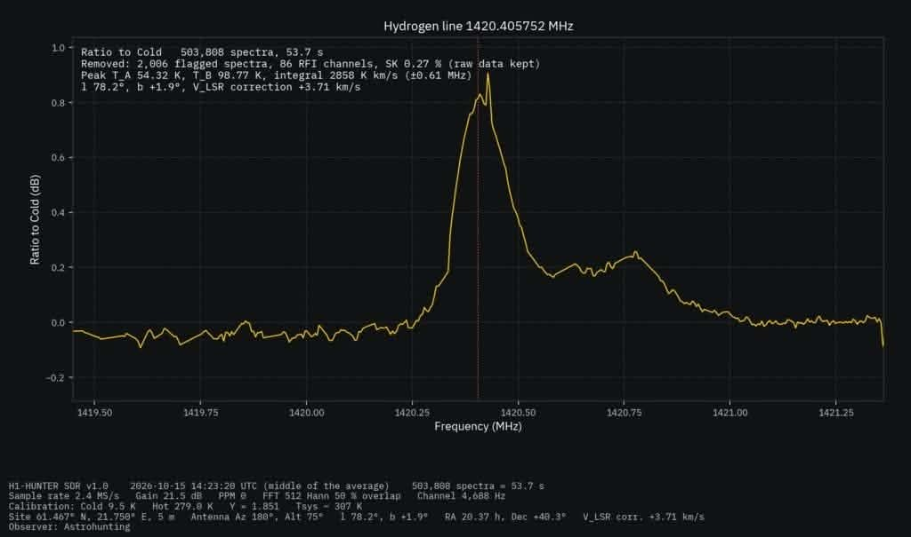
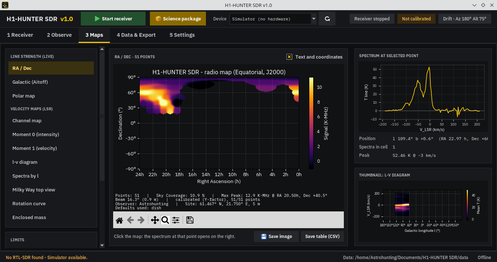
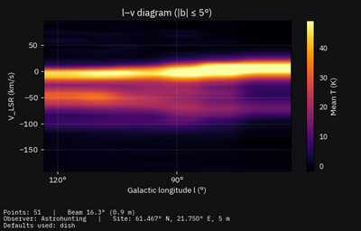
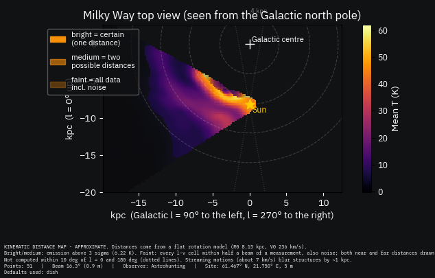

# H1-HUNTER SDR

**RTL-SDR receiver, 21 cm hydrogen line observatory and sky mapper in one program.**
Version 1.0 · Windows · Fedora Linux · Ubuntu · Raspberry Pi

H1-HUNTER SDR records the neutral hydrogen line (1420.405752 MHz) with an RTL-SDR stick and a small or large dish,
calibrates it to Kelvin, removes interference, and turns the measurements into sky maps, l–v diagrams, a Milky Way
top view and a rotation curve. Everything from raw samples to the scientific result happens in one program, and every
step is documented and reproducible from the saved files.

The program never uses the network. All saved data are plain text (CSV / JSON / TXT) or PNG; the only binary files are
the optional raw IQ recording (SigMF) and the optional FITS cube.

Everything runs in one graphical program: receiver, calibration, live hydrogen line, interference handling and maps
are tabs in the same window – no command line or scripting is needed.

## Screenshots

The tabs follow the order of an observation: receiver → observe → maps.


*1 Receiver – tuning, gain, Bias-T and the RF spectrum with waterfall.*


*2 Observe – pointing, calibration, the live hydrogen line, polar map and radiometer check.*


*A real observation towards Cygnus X (l 78.2°, b +1.9°) with a 0.9 m dish: calibrated, interference removed, raw data kept.*


*3 Maps – click any point of the map and its spectrum opens on the right.*

<p>


</p>

*l–v diagram and Milky Way top view made from 51 measured points.*

---

## Features

- **Receiver** – tuning, gain (tuner steps, no AGC), Bias-T, LO offset, DC handling, PPM correction and PPM test,
  RF spectrum and waterfall, sample-throughput monitor.
- **Calibration** – Cold (empty sky) → Hot (ground / absorber) Y-factor calibration with a computed Cold-sky model
  (CMB, Galaxy, atmosphere and an automatic ground-spillover model from altitude and dish size).
- **Bandpass and baseline removal** – each spectrum is divided by the Cold spectrum (P / P_cold, optionally with a smoothed Cold spectrum); after calibration a straight-line baseline fitted to the line-free channels is subtracted.
- **Interference handling** – time-domain flagging, exact *Remove flagged*, narrow RFI channel search that cannot
  remove the hydrogen line, optional per-channel **spectral kurtosis** flagging, user excluded frequency ranges.
  Raw data is never altered.
- **Hydrogen line view** – line temperature (baseline removed, default), antenna temperature, ratio to Cold, raw power
  and brightness temperature T_B; frequency, topocentric or LSR velocity axis; radiometer (1/√N) check.
- **Maps** – RA/Dec, Galactic (Aitoff), polar map, channel and moment maps, l–v diagram, spectra by longitude,
  Milky Way top view, rotation curve and enclosed mass.
- **Pointing** – drift scans with a fixed antenna, or guided with a GOTO mount (read only): ASCOM on Windows,
  INDI (KStars / Ekos) on Linux. Works with equatorial and Alt-Az mounts.
- **Optional hardware** – USB relay for a Dicke-type reference load (gain drift correction), temperature sensor for
  the Hot load (DS18B20 on a Raspberry Pi, USB serial sensor, ASCOM / INDI weather station or focuser),
  GPS-synchronised clock for interferometry station packets.
- **Data** – one CSV per measurement point with full metadata, flagged spectra for exact re-processing, scan log,
  calibration files, science package (README, spectra, maps, images, settings; optional FITS cube and ezRA file),
  raw IQ in SigMF format. With a GPS-synchronised clock the raw IQ recording is a **station packet** for
  H1-HUNTER INTERFEROMETER.

## Status

Version 1.0 has been tested with real RTL-SDR hardware and real 21 cm hydrogen line observations on Windows,
Fedora Linux and Raspberry Pi systems. Single-dish observing, calibration, mapping, Velocity Cube generation and
Science Package export have been tested with real RTL-SDR hardware and real hydrogen line observations.
Raw IQ recording has been validated with real data: the saved averages, the Y factor and T_sys are reproduced from
the raw samples, and gaps in a recording are marked.
Some optional components (for example certain external devices) are still under active validation.

## H1-HUNTER family

| Program | What it does | License |
|---|---|---|
| **H1-HUNTER SDR** (this repository) | Receiver, calibration, interference handling, maps, data export | Free, GPL v3 |
| **H1-HUNTER INTERFEROMETER** | Correlates station packets from two or more stations: clock solution, fringes, visibilities, UVFITS | Paid, source-available |
| **H1-HUNTER MOUNT** | GOTO mount control (INDI / ASCOM) with a sky chart and scan sequences | Paid, source-available |

H1-HUNTER SDR is complete on its own; the paid programs are separate. Income from the paid programs goes to the
development of the programs.

## Hardware

- RTL-SDR stick (TCXO models such as RTL-SDR Blog V3 / V4 recommended)
- LNA close to the feed and a hydrogen-line band-pass filter
- Dish or horn with a 1420 MHz feed – any size; the dish diameter is entered in the program
- Optional: GOTO mount, USB relay (LCUS-1 / CH340), temperature sensor, GPS time source

## Installation

The program is started with Python; there are no installer scripts. Download the package for your system from **[Releases](../../releases)** (or clone this repository) and follow the steps for your system. Internet is needed only for the installation; the program never uses the network. Without a stick, choose *Device: Simulator (no hardware)*.

| System | Package |
|---|---|
| Windows 10 / 11 | `H1-HUNTER_SDR_v1.0.zip` |
| Fedora 39+ | `H1-HUNTER_SDR_v1.0_Fedora.tar.gz` |
| Ubuntu 22.04+ (also Linux Mint, Pop!_OS, Debian) | `H1-HUNTER_SDR_v1.0_Ubuntu.tar.gz` |
| Raspberry Pi 3 / 4 / 5 (Raspberry Pi OS with desktop) | `H1-HUNTER_SDR_v1.0_RaspberryPi.tar.gz` |

Libraries: numpy, scipy, matplotlib, astropy (required); pyrtlsdr (RTL-SDR stick), pyserial (reference load relay) and pywin32 (ASCOM mounts, Windows) - see `requirements.txt`. The steps install them.

### Windows 10 / 11

Windows installation step by step. Copy each grey line completely into the Command Prompt and press Enter.

It is assumed that `H1-HUNTER_SDR_v1.0.zip` is in your **Downloads** folder.

**1. Open the Command Prompt:** press Start, type `cmd` and press Enter.

**2. Extract the program to your home folder:**

```bat
powershell -NoProfile -Command "Expand-Archive -Force -Path (Join-Path $env:USERPROFILE 'Downloads\H1-HUNTER_SDR_v1.0.zip') -DestinationPath $env:USERPROFILE"
```

**3. Install the libraries** (two lines; the second one makes sure that the RTL-SDR library is new enough):

```bat
py -m pip install --user numpy scipy matplotlib astropy pyserial pywin32
```

```bat
py -m pip install --user --upgrade "pyrtlsdr[lib]"
```

**4. RTL-SDR stick driver** (done with the mouse, only once). If the stick already works with other SDR programs, skip this.

- Download Zadig from <https://zadig.akeo.ie> and plug in the stick.
- In Zadig choose **Options → List All Devices**.
- Choose **Bulk-In, Interface (Interface 0)** from the list.
- Choose **WinUSB** on the right and press **Replace Driver**.

**5. Check.** The last line must be `RESULT: OK`.

```bat
py "%USERPROFILE%\H1-HUNTER_SDR\h1_hunter_sdr.py" --check
```

**6. Make a Desktop icon** (the last line must be `Exists: True`):

```bat
py -c "import os,sys,win32com.client as w;sh=w.Dispatch('WScript.Shell');d=os.path.join(os.environ['USERPROFILE'],'H1-HUNTER_SDR');t=os.path.join(os.path.dirname(sys.executable),'pythonw.exe');l=os.path.join(sh.SpecialFolders('Desktop'),'H1-HUNTER SDR.lnk');s=sh.CreateShortCut(l);s.TargetPath=t;s.Arguments=chr(34)+os.path.join(d,'h1_hunter_sdr.py')+chr(34);s.WorkingDirectory=d;s.IconLocation=os.path.join(d,'h1_hunter_sdr.ico');s.Save();print('Shortcut:',l);print('Starts:',t,os.path.exists(t));print('Exists:',os.path.exists(l))"
```

**7. Start:** double-click the Desktop icon **H1-HUNTER SDR**.

### Fedora 39 or newer

Open a terminal. Copy each grey block (the copy button at its right edge), paste it into the terminal with
**Ctrl+Shift+V** and press **Enter**. The administrator (sudo) password is asked.

**1. Install the system packages**

```bash
sudo dnf install -y python3 python3-pip python3-tkinter python3-numpy python3-scipy python3-matplotlib python3-matplotlib-tk python3-astropy python3-pyserial rtl-sdr xdg-user-dirs
```

**2. Extract the program to your home folder** (the package must be in your Downloads folder)

```bash
tar -xzf "$(xdg-user-dir DOWNLOAD)/H1-HUNTER_SDR_v1.0_Fedora.tar.gz" -C "$HOME"
```

**3. Make a Python environment for the program**

```bash
{
cd "$HOME/H1-HUNTER_SDR_Fedora"
python3 -m venv --system-site-packages venv
venv/bin/pip install --upgrade pip
venv/bin/pip install pyrtlsdr
venv/bin/python -c "import rtlsdr" || venv/bin/pip install "pyrtlsdr==0.2.93"
}
```

**4. Allow the RTL-SDR stick** (once per computer)

```bash
{
echo 'blacklist dvb_usb_rtl28xxu' | sudo tee /etc/modprobe.d/blacklist-rtlsdr.conf
sudo modprobe -r dvb_usb_rtl28xxu 2>/dev/null
printf '%s\n' 'SUBSYSTEM=="usb", ATTRS{idVendor}=="0bda", ATTRS{idProduct}=="2838", TAG+="uaccess", MODE="0666"' 'SUBSYSTEM=="usb", ATTRS{idVendor}=="0bda", ATTRS{idProduct}=="2832", TAG+="uaccess", MODE="0666"' | sudo tee /etc/udev/rules.d/20-rtlsdr.rules
sudo udevadm control --reload-rules && sudo udevadm trigger
sudo usermod -aG dialout "$USER"
}
```

Then unplug the stick and plug it in again, and log out and in once.

**5. Fonts and a menu icon**

```bash
{
mkdir -p "$HOME/.local/share/fonts/h1-hunter-sdr" "$HOME/.local/share/applications"
cp "$HOME/H1-HUNTER_SDR_Fedora"/fonts/*.ttf "$HOME/.local/share/fonts/h1-hunter-sdr/" && fc-cache -f "$HOME/.local/share/fonts"
printf '%s\n' '[Desktop Entry]' 'Type=Application' 'Name=H1-HUNTER SDR' "Exec=$HOME/H1-HUNTER_SDR_Fedora/venv/bin/python $HOME/H1-HUNTER_SDR_Fedora/h1_hunter_sdr.py" "Path=$HOME/H1-HUNTER_SDR_Fedora" "Icon=$HOME/H1-HUNTER_SDR_Fedora/h1_hunter_sdr.png" 'Terminal=false' 'Categories=Science;Astronomy;Education;' > "$HOME/.local/share/applications/h1-hunter-sdr.desktop"
chmod +x "$HOME/.local/share/applications/h1-hunter-sdr.desktop"
}
```

**6. Check** – the last line must be `RESULT: OK`

```bash
"$HOME/H1-HUNTER_SDR_Fedora/venv/bin/python" "$HOME/H1-HUNTER_SDR_Fedora/h1_hunter_sdr.py" --check
```

**7. Start** – *H1-HUNTER SDR* in the applications menu.

**Uninstall** (your measurements in `~/Documents/H1-HUNTER SDR` are kept)

```bash
{
rm -rf "$HOME/H1-HUNTER_SDR_Fedora" "$HOME/.local/share/applications/h1-hunter-sdr.desktop" "$HOME/.config/autostart/h1-hunter-sdr.desktop" "$HOME/.local/share/fonts/h1-hunter-sdr"
sudo rm -f /etc/modprobe.d/blacklist-rtlsdr.conf /etc/udev/rules.d/20-rtlsdr.rules
}
```

### Ubuntu 22.04 or newer (also Linux Mint, Pop!_OS, Debian)

Open a terminal. Copy each grey block (the copy button at its right edge), paste it into the terminal with
**Ctrl+Shift+V** and press **Enter**. The administrator (sudo) password is asked.

**1. Install the system packages**

```bash
sudo apt update && sudo apt install -y python3 python3-pip python3-venv python3-tk python3-numpy python3-scipy python3-matplotlib python3-astropy python3-serial rtl-sdr fontconfig xdg-user-dirs
```

**2. Extract the program to your home folder** (the package must be in your Downloads folder)

```bash
tar -xzf "$(xdg-user-dir DOWNLOAD)/H1-HUNTER_SDR_v1.0_Ubuntu.tar.gz" -C "$HOME"
```

**3. Make a Python environment for the program**

```bash
{
cd "$HOME/H1-HUNTER_SDR_Ubuntu"
python3 -m venv --system-site-packages venv
venv/bin/pip install --upgrade pip
venv/bin/pip install pyrtlsdr
venv/bin/python -c "import rtlsdr" || venv/bin/pip install "pyrtlsdr==0.2.93"
}
```

**4. Allow the RTL-SDR stick** (once per computer)

```bash
{
echo 'blacklist dvb_usb_rtl28xxu' | sudo tee /etc/modprobe.d/blacklist-rtlsdr.conf
sudo modprobe -r dvb_usb_rtl28xxu 2>/dev/null
printf '%s\n' 'SUBSYSTEM=="usb", ATTRS{idVendor}=="0bda", ATTRS{idProduct}=="2838", TAG+="uaccess", MODE="0666"' 'SUBSYSTEM=="usb", ATTRS{idVendor}=="0bda", ATTRS{idProduct}=="2832", TAG+="uaccess", MODE="0666"' | sudo tee /etc/udev/rules.d/20-rtlsdr.rules
sudo udevadm control --reload-rules && sudo udevadm trigger
sudo usermod -aG dialout "$USER"
}
```

Then unplug the stick and plug it in again, and log out and in once.

**5. Fonts and a menu icon**

```bash
{
mkdir -p "$HOME/.local/share/fonts/h1-hunter-sdr" "$HOME/.local/share/applications"
cp "$HOME/H1-HUNTER_SDR_Ubuntu"/fonts/*.ttf "$HOME/.local/share/fonts/h1-hunter-sdr/" && fc-cache -f "$HOME/.local/share/fonts"
printf '%s\n' '[Desktop Entry]' 'Type=Application' 'Name=H1-HUNTER SDR' "Exec=$HOME/H1-HUNTER_SDR_Ubuntu/venv/bin/python $HOME/H1-HUNTER_SDR_Ubuntu/h1_hunter_sdr.py" "Path=$HOME/H1-HUNTER_SDR_Ubuntu" "Icon=$HOME/H1-HUNTER_SDR_Ubuntu/h1_hunter_sdr.png" 'Terminal=false' 'Categories=Science;Astronomy;Education;' > "$HOME/.local/share/applications/h1-hunter-sdr.desktop"
chmod +x "$HOME/.local/share/applications/h1-hunter-sdr.desktop"
}
```

**6. Check** – the last line must be `RESULT: OK`

```bash
"$HOME/H1-HUNTER_SDR_Ubuntu/venv/bin/python" "$HOME/H1-HUNTER_SDR_Ubuntu/h1_hunter_sdr.py" --check
```

**7. Start** – *H1-HUNTER SDR* in the applications menu.

**Uninstall** (your measurements in `~/Documents/H1-HUNTER SDR` are kept)

```bash
{
rm -rf "$HOME/H1-HUNTER_SDR_Ubuntu" "$HOME/.local/share/applications/h1-hunter-sdr.desktop" "$HOME/.config/autostart/h1-hunter-sdr.desktop" "$HOME/.local/share/fonts/h1-hunter-sdr"
sudo rm -f /etc/modprobe.d/blacklist-rtlsdr.conf /etc/udev/rules.d/20-rtlsdr.rules
}
```

### Raspberry Pi 3 / 4 / 5 (Raspberry Pi OS with desktop)

Open a terminal. Copy each grey block (the copy button at its right edge), paste it into the terminal with
**Ctrl+Shift+V** and press **Enter**. The administrator (sudo) password is asked.

**0. Memory card.** Raspberry Pi Imager → *Raspberry Pi OS (with desktop)*; set your user name, password and Wi-Fi in
its settings. Put the package in the Downloads folder of the Raspberry Pi (for example from a USB stick).

**1. Install the system packages** (10–20 min on a Raspberry Pi 3)

```bash
sudo apt update && sudo apt install -y python3 python3-pip python3-venv python3-tk python3-numpy python3-scipy python3-matplotlib python3-astropy python3-serial rtl-sdr fontconfig xdg-user-dirs
```

**2. Extract the program to your home folder** (the package must be in your Downloads folder)

```bash
tar -xzf "$(xdg-user-dir DOWNLOAD)/H1-HUNTER_SDR_v1.0_RaspberryPi.tar.gz" -C "$HOME"
```

**3. Make a Python environment for the program**

```bash
{
cd "$HOME/H1-HUNTER_SDR_RaspberryPi"
python3 -m venv --system-site-packages venv
venv/bin/pip install --upgrade pip
venv/bin/pip install pyrtlsdr
venv/bin/python -c "import rtlsdr" || venv/bin/pip install "pyrtlsdr==0.2.93"
}
```

**4. Allow the RTL-SDR stick** (once per computer)

```bash
{
echo 'blacklist dvb_usb_rtl28xxu' | sudo tee /etc/modprobe.d/blacklist-rtlsdr.conf
sudo modprobe -r dvb_usb_rtl28xxu 2>/dev/null
printf '%s\n' 'SUBSYSTEM=="usb", ATTRS{idVendor}=="0bda", ATTRS{idProduct}=="2838", TAG+="uaccess", MODE="0666"' 'SUBSYSTEM=="usb", ATTRS{idVendor}=="0bda", ATTRS{idProduct}=="2832", TAG+="uaccess", MODE="0666"' | sudo tee /etc/udev/rules.d/20-rtlsdr.rules
sudo udevadm control --reload-rules && sudo udevadm trigger
sudo usermod -aG dialout,plugdev "$USER"
}
```

Then unplug the stick and plug it in again, and restart the Raspberry Pi.

**5. Fonts and a menu icon**

```bash
{
mkdir -p "$HOME/.local/share/fonts/h1-hunter-sdr" "$HOME/.local/share/applications"
cp "$HOME/H1-HUNTER_SDR_RaspberryPi"/fonts/*.ttf "$HOME/.local/share/fonts/h1-hunter-sdr/" && fc-cache -f "$HOME/.local/share/fonts"
printf '%s\n' '[Desktop Entry]' 'Type=Application' 'Name=H1-HUNTER SDR' "Exec=$HOME/H1-HUNTER_SDR_RaspberryPi/venv/bin/python $HOME/H1-HUNTER_SDR_RaspberryPi/h1_hunter_sdr.py" "Path=$HOME/H1-HUNTER_SDR_RaspberryPi" "Icon=$HOME/H1-HUNTER_SDR_RaspberryPi/h1_hunter_sdr.png" 'Terminal=false' 'Categories=Science;Astronomy;Education;' > "$HOME/.local/share/applications/h1-hunter-sdr.desktop"
chmod +x "$HOME/.local/share/applications/h1-hunter-sdr.desktop"
}
```

**6. Check** – the last line must be `RESULT: OK`

```bash
"$HOME/H1-HUNTER_SDR_RaspberryPi/venv/bin/python" "$HOME/H1-HUNTER_SDR_RaspberryPi/h1_hunter_sdr.py" --check
```

**7. Start** – *H1-HUNTER SDR* in the applications menu.

**Optional: start automatically, full screen** (F11 or Esc leaves full screen)

```bash
{
mkdir -p "$HOME/.config/autostart"
sed 's|h1_hunter_sdr.py$|h1_hunter_sdr.py --fullscreen|' "$HOME/.local/share/applications/h1-hunter-sdr.desktop" > "$HOME/.config/autostart/h1-hunter-sdr.desktop"
sudo raspi-config nonint do_boot_behaviour B4
}
```

**Optional: remote viewing with VNC**

```bash
sudo raspi-config nonint do_vnc 0
```

**Uninstall** (your measurements in `~/Documents/H1-HUNTER SDR` are kept)

```bash
{
rm -rf "$HOME/H1-HUNTER_SDR_RaspberryPi" "$HOME/.local/share/applications/h1-hunter-sdr.desktop" "$HOME/.config/autostart/h1-hunter-sdr.desktop" "$HOME/.local/share/fonts/h1-hunter-sdr"
sudo rm -f /etc/modprobe.d/blacklist-rtlsdr.conf /etc/udev/rules.d/20-rtlsdr.rules
}
```

### Running from source

```bash
pip install -r requirements.txt     # tkinter comes with Python (Linux: python3-tkinter / python3-tk)
python h1_hunter_sdr.py
```

## First light

1. Start the receiver.
2. Point at empty sky far from the Milky Way and press **1. Cold**.
3. Point at the ground or cover the feed with an absorber and press **2. Hot**.
4. Point at the Milky Way.
5. Press **3. Measure**.
6. Open **Maps**.

## Documentation

- **User manual** (English / Finnish): [open in the browser](https://jsuominen-astrohunting.github.io/H1-HUNTER-SDR/h1h/MANUAL.html) (file `h1h/MANUAL.html`) – also opened from
  *Settings → User manual* in the program.
- **Methods** – measurement, calibration and interference handling, with every formula and threshold:
  [`docs/H1-HUNTER_SDR_v1.0_Methods.pdf`](docs/H1-HUNTER_SDR_v1.0_Methods.pdf)
  (source: [`docs/methods/build_methods.py`](docs/methods/build_methods.py)).

## Scientific notes

- Calibration: `T_A = (Tsys + T_cold) · P / P_cold − Tsys`, `Tsys = (T_hot − Y · T_cold) / (Y − 1)`.
- Brightness temperature: `T_B = T_L / η` with `η = 1.0` by default, because Galactic HI is extended and fills the
  beam; verified against the LAB survey at the program's beam. A measured value can be entered.
- The absolute temperature scale is approximate (about 10–20 %): the hot-load temperature, the Cold-sky model and
  spillover are estimates. Line shapes and velocities are much more accurate.
- No stray-radiation correction yet.
- Comparison with the LAB / HI4PI surveys is recommended.

See the Methods document, section 9, for the full list of known limitations.

## Station packets and timing

H1-HUNTER SDR records station packets (raw IQ with `station.json`) but does not correlate them; correlation is done in
H1-HUNTER INTERFEROMETER. H1-HUNTER SDR uses the computer clock for time stamps; it does not read a GPS receiver
directly. For interferometry every station's clock must be synchronised to GPS: use a GNSS receiver with a PPS output (e.g. a u-blox M8 / M9
module) with gpsd and chrony on Linux / Raspberry Pi (PPS on a GPIO pin on the Pi), or GPS time-synchronisation
software on Windows, then tick *Receiver → GPS synchronized clock*. The fringe search assumes the station clocks agree
within ±10 ms; a USB GPS without PPS (typically 10–50 ms) is not sufficient.

## Repository layout

```
h1_hunter_sdr.py      program start
h1h/                  program source (and MANUAL.html)
fonts/                IBM Plex Sans / Mono (SIL Open Font License 1.1)
h1_hunter_sdr.ico/.png  program icons (Windows / Linux shortcuts)
docs/                 Methods document and its source
requirements.txt      Python libraries for running from source
CHANGELOG.md          changes per version
LICENSE               GNU General Public License version 3
```

## License

H1-HUNTER SDR is free software, licensed under the GNU General Public License v3. You may use it freely. If you
copy, modify or distribute it, the terms of the GPL v3 apply (file [`LICENSE`](LICENSE)).

H1-HUNTER SDR is free software: you can redistribute it and/or modify it under the terms of the
**GNU General Public License version 3** as published by the Free Software Foundation. It is distributed in the hope
that it will be useful, but WITHOUT ANY WARRANTY; without even the implied warranty of MERCHANTABILITY or FITNESS FOR A
PARTICULAR PURPOSE. See [`LICENSE`](LICENSE).

Copyright © 2026 Jarkko Suominen

### Third-party components

- [pyrtlsdr](https://github.com/pyrtlsdr/pyrtlsdr) (GPL-3.0) and librtlsdr (GPL-2.0-or-later) – RTL-SDR access
- NumPy, SciPy, Matplotlib, Astropy, pySerial, pywin32 – their own open-source licenses
- IBM Plex fonts – SIL Open Font License 1.1 (`fonts/OFL-license.txt`)

## Credits

H1-HUNTER SDR is designed, tested and maintained by **Jarkko Suominen** (Pori, Finland).
Development was assisted by Claude (Anthropic).
